<div align="center">

# 6G ISAC Simulator: Radar From a Data Signal

### What if every 6G base station were also a radar?


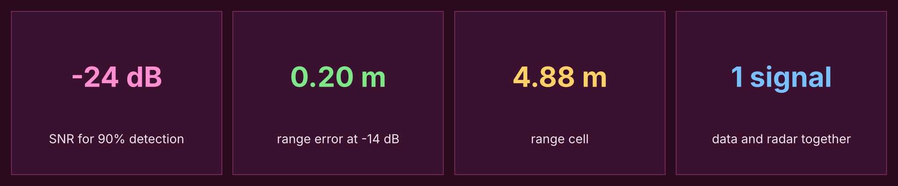

</div>

This simulator sends normal 16-QAM OFDM data, listens to the echoes, and finds the range and speed of targets with the same waveform used for communication.

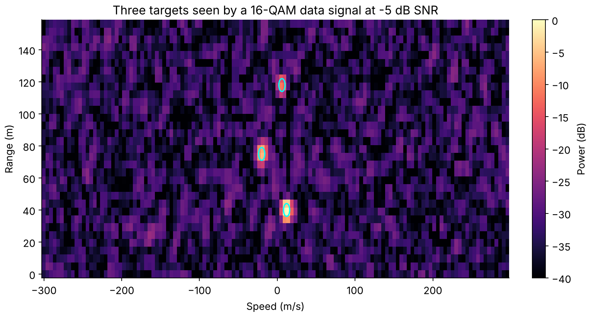

The three circles mark the true targets, found from data symbols alone at -5 dB SNR per resource element.

## Contents

- [Key results](#key-results)
- [Flowchart](#flowchart)
- [How it works](#how-it-works)
- [Result gallery](#result-gallery)
- [System numbers](#system-numbers)
- [Run it](#run-it)
- [Limits](#limits)
- [Next steps](#next-steps)

## Key results

28 GHz carrier, 120 kHz subcarrier spacing, 256 subcarriers, 128 symbols, with 2-D CA-CFAR detection. The table uses 200 trials per SNR point.

| Sensing resources | SNR for 90% detection | Ghost detections per frame at -14 dB | Range RMSE at -14 dB |
|---|---:|---:|---:|
| All subcarriers | -24 dB | 0.4 | 0.20 m |
| 1 of every 2 | -22 dB | 6.5 | 0.24 m |
| 1 of every 4 | -18 dB | 13.6 | 0.34 m |
| 1 of every 8 | -16 dB | 21.2 | 0.45 m |

What this shows:

- Coherent processing over the frame finds a target far below 0 dB SNR.
- Using 1 of every 8 subcarriers costs **8 dB** of sensitivity and creates ghost targets, because the comb folds range into copies.
- **Denser data hurts the radar:** 90% detection needs about -28 dB with QPSK, -25 dB with 16-QAM and -23 dB with 64-QAM, because dividing by low-power symbols boosts noise.
- Doubling the frame from 128 to 256 symbols improves sensitivity by about 2 dB.
- Two equal targets at the same speed were always separated at 14 m, which is about 3 range cells, because the window widens the peak.

## Flowchart

<p align="center">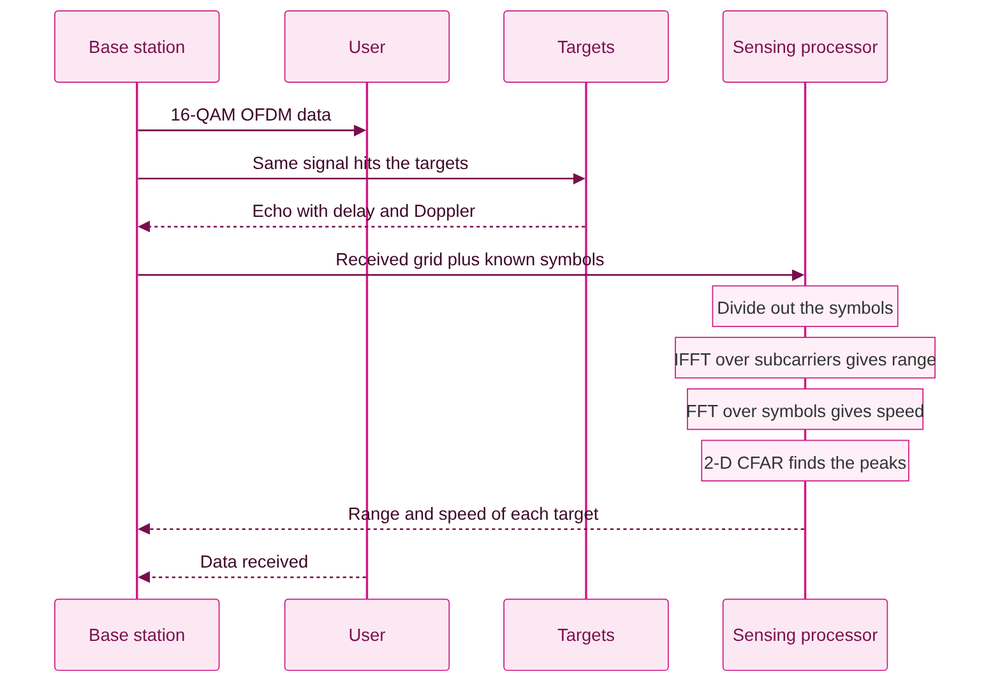</p>

## How it works

1. Build a grid of random 16-QAM symbols.
2. Apply each target's delay across subcarriers and its Doppler shift across symbols, then add noise.
3. Divide the received grid by the known symbols.
4. Take an IFFT over subcarriers and an FFT over symbols to get the range-Doppler map.
5. Detect peaks with 2-D CA-CFAR.

A base station that transmits the signal knows all its data symbols, so it can sense on every subcarrier. The sparse cases model a receiver that only knows the pilots.

## Result gallery

| Detection | Pilot-only sensing |
|---|---|
| 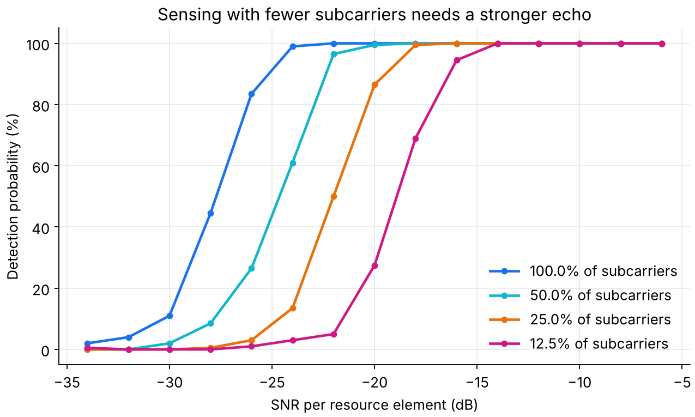 | 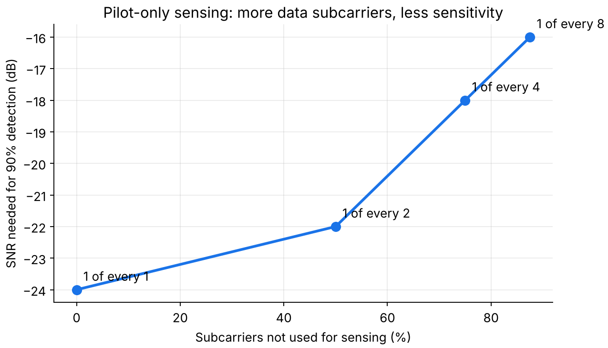 |

| Effect of modulation | Effect of frame length |
|---|---|
| 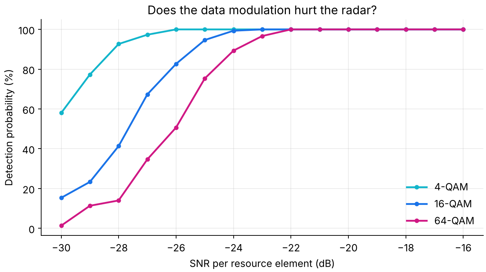 | 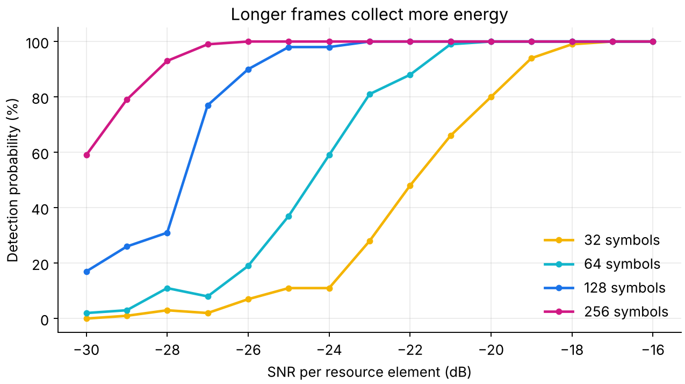 |

| Separating two targets | Weak target beside a strong one |
|---|---|
| 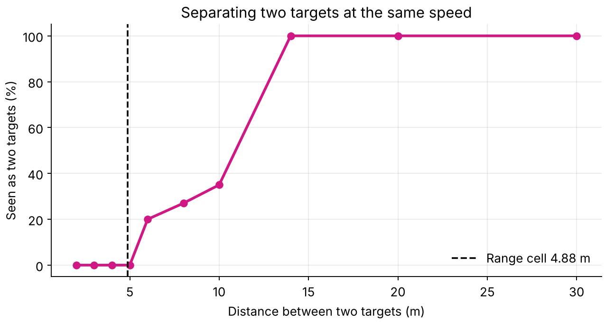 | 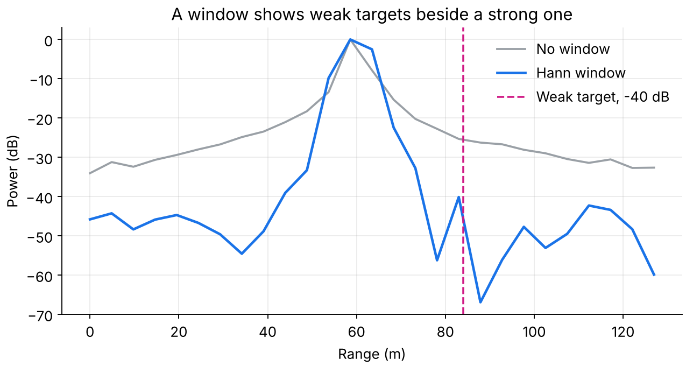 |

| Range accuracy | Communication side |
|---|---|
| 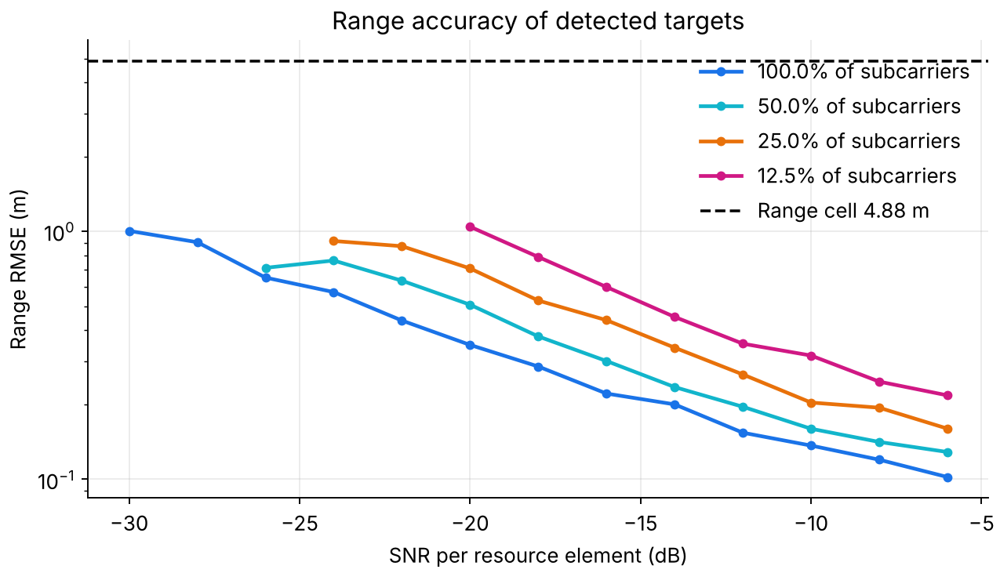 | 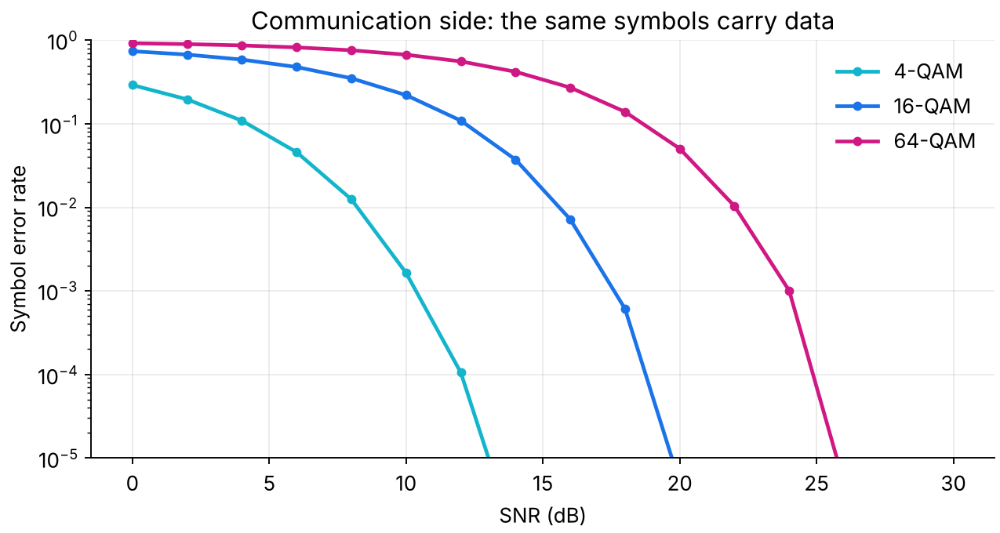 |

## System numbers

| Quantity | Value |
|---|---:|
| Range resolution | 4.88 m |
| Maximum range | 1,250 m |
| Speed resolution | 4.69 m/s |
| Maximum speed | ±300 m/s |

## Run it

```bash
pip install -r requirements.txt
python run_all.py     # about 2 minutes
pytest tests
```

## Limits

- This is a simulation of point targets in white noise, with no hardware and no real channel.
- It ignores clutter, phase noise, self-interference and beam patterns.
- SNR is per resource element, so a link budget is needed to turn it into real distances.

## Next steps

- [ ] Add clutter and phase noise
- [ ] Add multi-antenna beamforming
- [ ] Test with real software-defined radio captures

## Author

**Jaafar Salim**, University of Technology, Iraq
